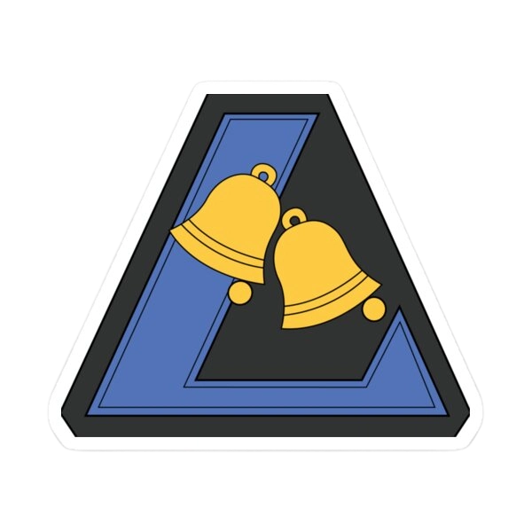

<div align="center">

[](https://github.com/shuglx/loudmail/releases)

[](https://github.com/shuglx/loudmail/releases)


</div>

按你的规则盯邮件：命中指定发件人 / 标题关键词的邮件到达后，自动播放报警语音。基于 Tauri（Rust + React）构建，通过本机 **Coremail（e企邮）MCP** 服务只读检索邮箱。

## 为什么做这个

值班场景里真正要紧的邮件（SOC 安全告警、数据库告警、系统故障通知）往往混在大量通知里，靠人隔一会儿切到邮箱看一眼并不可靠；而这类告警本身有时间要求（比如 15 分钟内必须处置）。

LoudMail 把"盯邮件"这件事自动化：**匹配规则 → 轮询检索 → 命中就播报警音**，人不在邮件页面前也不会漏。同时把语音素材做成可自选的语音库（内置铃声、上传、录音、文本转语音），并支持铃声与人声合成，让报警既响亮又能直接听懂是什么事。

<div align="center">
  
</div>

## 核心功能

- **匹配策略**：每条策略 = 发件人（必填，从 `<...>` 提取地址、模糊匹配、忽略大小写）+ 标题关键词（必填，支持模糊/开头/结尾三种匹配）+ 报警语音 + 播报次数（1~3 次），可启用/停用、拖动排序；策略按顺序从上至下匹配
- **只播一次**：按邮件 `mailId` 去重并维护策略游标，命中后不会因下一轮轮询重复报警
- **过滤转发/回复**：可选跳过标题以「转发/回复 + 冒号」开头的邮件，避免噪音
- **本地 MCP 接入**：走标准 MCP（SSE + JSON-RPC）连接本机 e企邮服务，调用 `mail_search` 检索，不在应用里存账号密码
- **语音库**：内置 5 段铃声（编译期嵌入 `alert-sound/`），并支持上传 WAV/MP3/OGG、最长 15 秒录音、文本转语音
- **语音合成**：联网服务（微软 Edge，晓晓 / 云扬，需外网）或内网 TTS 服务（WebSocket，vivian / ryan，需内网可达）二选一
- **铃声 + 人声合成**：把内置铃声循环 N 次与录制/合成的人声拼成一段报警音，试听后入库
- **播报记录**：最近 500 条，支持关键词搜索、按策略筛选、分页与详情查看（标题、发件人、摘要、语音、邮件 ID）
- **托盘常驻**：关窗即隐藏到托盘，菜单可一键「暂停播报」，暂停时停止轮询与当前播放
- **连接自检**：设置页分 TCP 探测与 SSE 握手两步检测，并显示对端服务名/版本
- **数据全本地**：配置、策略、记录、语音均为本机 JSON 与文件，无云端账号、无同步
- **开机自启、单实例**：登录后自动运行，重复启动只唤起已有窗口

## 页面

| 页面 | 作用 |
| --- | --- |
| 匹配策略 | 维护发件人 / 关键词 / 语音 / 次数，启用与排序 |
| 播报记录 | 命中历史，搜索、筛选、查看详情、清空 |
| 语音库 | 内置铃声、上传、录音、文本转语音、铃声与人声合成 |
| 设置 | MCP 端点与连接测试、扫描周期、检索时间窗、TTS、存储路径、开机自启 |

## 安装

从 [Releases](https://github.com/shuglx/loudmail/releases) 下载对应平台的包：

**银河麒麟 / Ubuntu（ARM64）**

```bash
sudo dpkg -i loudmail_x.y.z_arm64.deb
# 依赖 WebKitGTK 4.0 / GTK3 等系统自带库，如缺依赖可执行: sudo apt -f install
```

**macOS（Apple Silicon）**

1. 打开 `LoudMail_x.y.z_aarch64.dmg`，拖入「应用程序」；
2. 未做 Apple 开发者签名，首次运行若提示"未验证开发者"，右键（或 Control + 单击）图标 → 打开放行；若系统仍报"已损坏"，执行：

   ```bash
   xattr -dr com.apple.quarantine /Applications/LoudMail.app
   ```

3. 首次录音时按系统提示授权麦克风。

**Windows（绿色版，x64）**

1. 解压 `loudmail_x.y.z_win-x64-portable.zip`，双击其中的 `loudmail.exe` 即可，无需安装；建议放在不含空格/中文的目录；
2. 依赖 WebView2 运行时（Windows 10 1809+ / Windows 11 通常已自带，缺失时安装微软 Evergreen 运行时）；
3. 数据与日志位于 `%APPDATA%\com.loudmail.app`；开机自启写入 `HKCU\Software\Microsoft\Windows\CurrentVersion\Run`。

启动后在「设置」里确认 MCP 端点（默认 `127.0.0.1:11328`）为已连接，再新建一条策略即可。

## 从源码构建

```bash
npm install
npm run tauri:dev      # 开发调试
npm run tauri:build    # 本地出包
npm run check          # cargo check
```

> Linux 产物基于 Ubuntu 20.04(focal) 容器构建（`docker/Dockerfile.build`），把 webkit2gtk 锁定在 2.28.1，
> 与麒麟 V10 目标机的 glibc / WebKitGTK 基线对齐；构建完成后用 `./scripts/package-deb.sh` 打出 arm64 deb。
> macOS 侧 Tauri v1 不签 .app，直接出的 dmg 会带失败的临时签名，故先用
> `npx tauri build --bundles app` 再执行 `./scripts/package-dmg.sh` 补足 bundle 级 ad-hoc 签名后打包。
> CI 在推送 `v*` 标签时同时产出 deb 与 dmg 并附加到 Release。

## 本地联调

没有 e企邮客户端的机器上，可用内置模拟服务代替真实 MCP：

```bash
npm run mock:coremail   # 每 5 秒生成一封 SOC / DB 模拟邮件
```

模拟服务监听 `127.0.0.1:11328`，提供 `/sse` 与 `/mcp`；也可在「设置」中打开「模拟邮箱」开关，使用应用内置的 Mock 数据源。开发时可用 `LOUDMAIL_DATA_DIR` 指定独立数据目录。

## 数据与隐私

数据默认存放在应用数据目录（`com.loudmail.app`）下：

- `config.json` 配置、`strategies.json` 策略、`history.json` 播报记录、`sounds.json` 语音元数据；
- `sounds/` 语音文件、`recordings/` 录音、`logs/` 运行日志（「设置 → 存储」可直接打开对应文件）。

应用只通过本机 MCP 读取邮件检索结果，不修改邮箱内容；除可选的在线 TTS 外不发生任何外部网络请求。

## 许可

MIT
